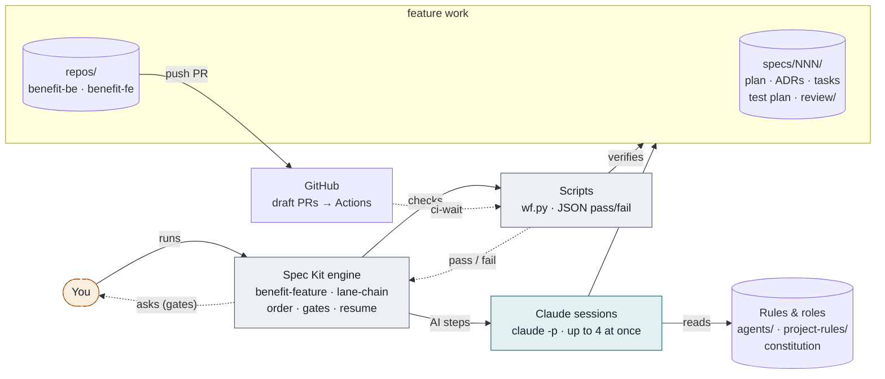
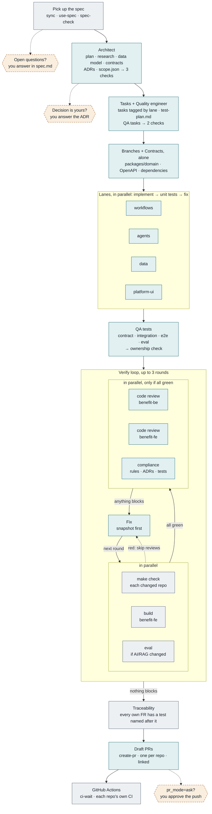

# Benefits Feature Pipeline

One command takes an approved spec to draft pull requests in `benefit-be` and `benefit-fe`. Claude sessions plan, build and review; scripts check every step; you're asked only when a decision is yours.

```bash
specify workflow run workflows/benefit-feature/workflow.yml -i feature=003   # or /feature-workflow in chat
```

A designed version of this page is published as an artifact: [Benefits Feature Pipeline](https://claude.ai/artifact/M1L7pdUf9uMiZK6A2LhJ94) (private; share it from the page's Share menu). This file is the source of truth; update it when the workflow changes.

**Legend:** teal = AI session (Claude, one role or agent) · grey = script (deterministic check or command) · amber dashed = you (only when needed).

## 1. How the pieces fit



The engine never writes code. It starts **Claude sessions** for work that needs judgement (planning, tasks, test design, coding, reviewing, fixing) and **scripts** for everything that can be checked mechanically, and moves on only when a script says the last step passed. Only the PR step leaves your machine.

## 2. The pipeline



Stages that depend on each other run in a chain. Work that doesn't (the four lanes, the tests and builds, the three reviews) runs in parallel. In the verify loop, a red test or build goes straight to **Fix** without spending tokens on reviews. Any failed check stops the run; fix the cause and `specify workflow resume <run-id>`.

## 3. Stage by stage

| # | Stage | What happens | Output | Checked by |
|---|---|---|---|---|
| 0 | Spec (you) | You write the spec with `/speckit-specify` and `/speckit-clarify`. The run starts from it. | `spec.md` | `spec-check` |
| 1 | Plan (AI) | The architect plans against the real code, the constitution and earlier decisions, records significant decisions as ADRs, and decides which lanes and repos are involved. | `plan.md`, `research.md`, `data-model.md`, `contracts/`, `decisions/`, `scope.json` | `plan-check`, `decisions-check`, `scope-check` |
| 2 | Tasks + QA (AI) | Spec Kit's tasks, each tagged with one lane and repo; then the quality engineer maps every requirement to named test cases and adds test-first and cross-lane QA tasks. One session, so the plan is read once. | `tasks.md`, `test-plan.md` | `tasks-split`, `test-plan-check` |
| 3 | Contracts (AI) | Feature branches from `origin/main`, then the shared changes every lane depends on, done first and alone. | domain models, OpenAPI, dependencies | `branches` |
| 4 | Lanes (AI ×4) | Each lane implements its own tasks, tests first, in its own folders; runs its unit tests and fixes failures (up to 2 rounds). | code per lane | `lane-tests` |
| 5 | QA tests (AI) | Tests that span lanes or repos: contract, integration, end-to-end, eval. | tests | `ownership` |
| 6 | Verify (script + AI) | Tests, builds and evals in parallel. If all green, code reviews and the compliance review in parallel. If anything blocks, one fix session, then the next round. | `review/verify.md` | `verify-status` |
| 7 | Trace (script) | Every requirement of the feature's own spec (`FR-<NNN>-xx`) must have a test named after it (`test_FR_010_01_…`). Other specs' IDs that the spec only refers to are left to those specs; the task and test-plan checks count the same set. | `review/trace.md` | `trace` |
| 8 | Ship (AI + script) | Draft PRs, one per repo and linked (backend first if the API changed); then waits for each repo's GitHub Actions. | PR URLs | `ci-wait` |

## 4. Who does what

A **role** is a folder with `rules/behavior.md` (role, scope, responsibilities, evidence, editing and communication rules) and its skills; whichever session runs a skill takes on the role. An **agent** is a single `.agent.md` file. All follow the shared conventions in [agents/README.md](../agents/README.md).

| Who | Kind | Does | Writes | Skills |
|---|---|---|---|---|
| [Architect](../agents/architect/) | role | Turns the spec into a buildable plan; makes the decisions that are expensive to get wrong | plan artefacts, ADRs, `scope.json` | `architecture-plan`, `architecture-decision`, `architecture-capabilities` |
| [Quality engineer](../agents/quality-engineer/) | role | Decides how each requirement is proven: test level, edge cases, synthetic data, eval thresholds | `test-plan.md`, test and QA tasks | `test-strategy` |
| [Compliance reviewer](../agents/compliance-reviewer/) | role | Checks the implementation against the constitution, the rules for each changed path, Accepted ADRs and the test plan | `review/compliance.md` + `.json` | `compliance-review` |
| [Backend reviewer](../agents/backend-reviewer.agent.md) | agent | Senior code review of `benefit-be`: bugs, async and MongoDB mistakes, Temporal in practice, security, tests, design | `review/code-benefit-be.md` + `.json` | — |
| [Frontend reviewer](../agents/frontend-reviewer.agent.md) | agent | Senior code review of `benefit-fe`: state and data bugs, security, accessibility, tests, API-contract fit | `review/code-benefit-fe.md` + `.json` | — |

**Lanes** (workflows, agents, data, platform-ui) are folder ownership, not agents ([backend-architecture.md](../project-rules/backend-architecture.md)). They decide which rules apply (`TW-*`, `AG-*`, `KD-*`, `PL-*`, `FE-*`) and what can run in parallel.

## 5. When it asks you

| Gate | Appears when | What you do | Continue with |
|---|---|---|---|
| Spec questions | The spec still has `[NEEDS CLARIFICATION]` markers | Answer them in `spec.md` | `-i spec_verdict=approve` |
| Your decisions | An ADR is a product, policy or cost call, or needs a rule or constitution change | Answer it, or accept the ADR's fallback | `-i decision_verdict=approve` |
| Before pushing | Only with `pr_mode=ask` | Read `review/verify.md`, `review/trace.md` and the diff | `-i pr_verdict=approve` |

With the default `pr_mode=draft`, your review happens on the draft PRs in GitHub, where branch protection already requires an approval. Use `pr_mode=none` for a rehearsal that stops before pushing. Each gate has its own answer, so approving one can never approve another.

## 6. How it stays correct, and cheap

**Verification**
- A script check follows every AI step; any failure stops the run with a JSON list of problems.
- Every requirement must have a test case in the plan and a test named after it in the code.
- Parallel lanes share one working tree, so `ownership` fails the run if any lane edited files it doesn't own.
- A missing or unreadable review result counts as blocking, so a broken step can't wave the run through.
- Each repo's own GitHub Actions must pass on the PR.

**Token economy**
- Three AI sessions plan the whole feature: architect; tasks with quality engineering; contracts.
- Reviews run only on green builds; a red round goes straight to the fix.
- Re-reviews read only what changed since the snapshot taken before the fix.
- Each role reads only the rule files mapped to the paths it touches, and the diff.
- Results go to files; replies are a few lines.

## 7. Running it

```bash
# once
gh auth login                       # and clone both repos into repos/ (/clone-repo)

# build spec 003 (from a terminal, gates ask you directly)
specify workflow run workflows/benefit-feature/workflow.yml -i feature=003
specify workflow run workflows/benefit-feature/workflow.yml -i feature=003 -i pr_mode=none   # rehearsal

# follow it
specify workflow status <run-id>    # which step, and why it stopped
specify workflow resume <run-id>    # after fixing a failed check
specify workflow resume <run-id> -i decision_verdict=approve
```

AI steps run unattended (`claude -p`, up to four at once), so they can't ask permission: allow the scripts, `git`, `make`, `uv`, `pnpm`, `python3` and `gh` in your Claude Code settings first. The engine runs Claude Code; Copilot users follow the same stages by hand from [workflows/feature.md](../workflows/feature.md).

## 8. Where things live

```
ai-immersion-metarepo/
├── docs/workflow-architecture.md      this page
├── workflows/
│   ├── feature.md                     the stages, and the manual path
│   ├── benefit-feature/workflow.yml   the pipeline
│   ├── benefit-feature/scripts/wf.py  every check
│   └── lane-chain/workflow.yml        one lane: implement → test → fix
├── agents/
│   ├── README.md                      who's who + shared conventions
│   ├── architect/                     rules/behavior.md + 3 skills
│   ├── quality-engineer/              rules/behavior.md + test-strategy
│   ├── compliance-reviewer/           rules/behavior.md + compliance-review
│   ├── backend-reviewer.agent.md
│   └── frontend-reviewer.agent.md
├── project-rules/                     rule sets with IDs; README maps paths → rules
├── .specify/memory/constitution.md    principles I–X; overrides everything
├── specs/<NNN-feature>/               spec, plan, ADRs, tasks, test plan, review/
└── repos/benefit-be, repos/benefit-fe the code, on feature/<NNN-feature>
```
