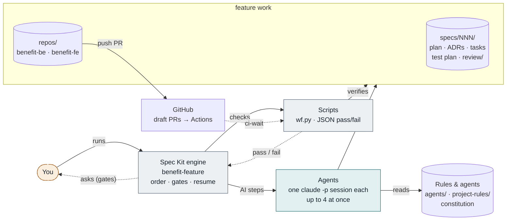
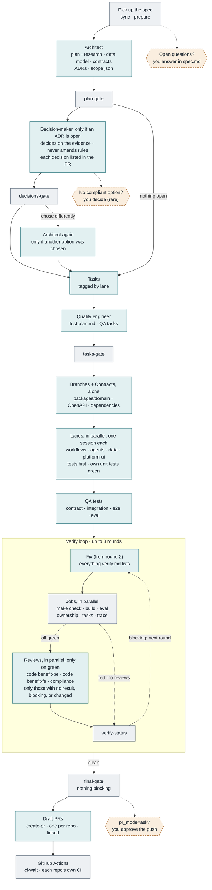
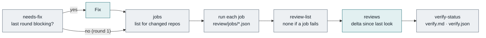

# Benefits Feature Pipeline

One command takes an approved spec to draft pull requests in `benefit-be` and `benefit-fe`. Separate agents plan, decide, build and review; scripts check every step; you're asked only when automation can't decide, and you review the result on the draft PRs.

```bash
workflows/benefit-feature/run.sh start 003 ask    # or /feature-workflow in chat
workflows/benefit-feature/run.sh watch            # live progress, in a second terminal
```

A designed version of this page is published as an artifact: [Benefits Feature Pipeline](https://claude.ai/artifact/M1L7pdUf9uMiZK6A2LhJ94) (private; share it from the page's Share menu). This file is the source of truth; update it when the workflow changes.

**Legend:** teal = AI session (one agent, its own `claude -p` session) · grey = script (deterministic check or command) · amber dashed = you (only when needed).

## 1. How the pieces fit



The engine never writes code. It is the orchestrator: it starts each **agent** as its own session, with its own context, for work that needs judgement (planning, tasks, test design, coding, reviewing, fixing) and **scripts** for everything that can be checked mechanically, and moves on only when a script says the last step passed. Only the PR step leaves your machine.

## 2. The pipeline



Each teal box is a separate agent session. Stages that depend on each other run in a chain; work that doesn't (the four lanes, the jobs, the reviews) runs in parallel. Planning is checked by one gate per stage; everything about the code is checked inside the verify loop, so any failure there goes to **Fix** instead of stopping the run. Each round ends on a verification, so a fix is never shipped unchecked. A failed gate stops the run; fix the cause and `specify workflow resume <run-id>`.

### Inside one verify round



`review-list` reruns a review only when it has no result, still has blocking findings, or one of its repos changed since it last looked. It records the trees it reviewed, so `wf.py delta` can show a re-review exactly what changed, new files included.

## 3. Stage by stage

| # | Stage | What happens | Output | Checked by |
|---|---|---|---|---|
| 0 | Spec (you) | You write the spec with `/speckit-specify` and `/speckit-clarify`. The run starts from it. | `spec.md` | `prepare` |
| 1 | Plan (AI) | The architect agent plans against the real code, the constitution and earlier decisions, records significant decisions as ADRs, and decides which lanes and repos are involved. Product, policy, cost, scope and amendment questions stay open, with options and a recommendation. | `plan.md`, `research.md`, `data-model.md`, `contracts/`, `decisions/`, `scope.json` | `plan-gate` |
| 1b | Decide (AI) | Only if an ADR is open: the decision-maker agent, which didn't plan the feature, decides each one on the evidence and records why and when to revisit. If it chose other than the recommendation, the architect updates the plan. | decided ADRs, `decisions/auto-decisions.json` | `decisions-gate`, `plan-gate` |
| 2 | Tasks, then QA (AI ×2) | Spec Kit's tasks, each tagged with one lane and repo; then, in its own session, the quality-engineer agent maps every requirement to named test cases and adds test-first and cross-lane QA tasks. | `tasks.md`, `test-plan.md` | `tasks-gate` |
| 3 | Contracts (AI) | Feature branches from `origin/main` in the repos in `scope.json`, then the shared changes every lane depends on, done first and alone. | domain models, OpenAPI, dependencies | verify loop |
| 4 | Lanes (AI ×4) | Each lane implements its own tasks, tests first, in its own folders, and gets its own unit tests green in the same session. | code per lane, `lanes/<lane>/done.json` | verify loop |
| 5 | QA tests (AI) | Tests that span lanes or repos: contract, integration, end-to-end, eval. | tests | verify loop |
| 6 | Verify (script + AI) | Fix (from round 2), then in parallel: `make check`, builds, evals, `ownership` (files in their lane), `tasks` (none left open) and `trace` (every planned test defined by its exact name and not skipped). If all green, the reviews that need it, in parallel. | `review/verify.md`, `review/trace.md` | `verify-status`, `final-gate` |
| 7 | Ship (AI + script) | Draft PRs, one per repo and linked (backend first if the API changed); then waits for each repo's GitHub Actions. | PR URLs | `ci-wait` |

## 4. Who does what

Every AI step is an **agent**: a `*.agent.md` file with its rules (role, scope, responsibilities, evidence, editing and communication), plus its own procedures in `skills/` when it has any. Each runs as a separate subagent with its own context and talks to the others only through files. The engine starts them, in parallel where the work is independent; in chat, the main session does the same (for example the three reviewers through `review-changes`). Shared conventions: [agents/README.md](../agents/README.md).

| Agent | Does | Writes | Skills |
|---|---|---|---|
| [Architect](../agents/architect/architect.agent.md) | Turns the spec into a buildable plan; makes the decisions that are its to make; frames the rest with options and a recommendation | plan artefacts, ADRs, `scope.json` | `architecture-plan`, `architecture-decision`, `architecture-capabilities` |
| [Decision-maker](../agents/decision-maker.agent.md) | Decides the open ADRs independently, on the evidence: product and scope by the spec, policy by its sources, cost by the cheapest compliant option; never amends the constitution or a rule | decided ADRs, `decisions/auto-decisions.json` | — |
| [Quality engineer](../agents/quality-engineer/quality-engineer.agent.md) | Decides how each requirement is proven: test level, edge cases, synthetic data, eval thresholds | `test-plan.md`, test and QA tasks | `test-strategy` |
| [Compliance reviewer](../agents/compliance-reviewer/compliance-reviewer.agent.md) | Checks the implementation against the constitution, the rules for each changed path, Accepted ADRs and the test plan | `review/compliance.md` + `.json` | `compliance-review` |
| [Backend reviewer](../agents/backend-reviewer.agent.md) | Senior code review of `benefit-be`: bugs, async and MongoDB mistakes, Temporal in practice, security, tests, design | `review/code-benefit-be.md` + `.json` | — |
| [Frontend reviewer](../agents/frontend-reviewer.agent.md) | Senior code review of `benefit-fe`: state and data bugs, security, accessibility, tests, API-contract fit | `review/code-benefit-fe.md` + `.json` | — |

The decision-maker is separate from the architect on purpose: the agent that framed the options doesn't grade them. Its decisions aren't hidden: each one is in `decisions/README.md` and in a "Decided automatically" section of the PR, with what the architect recommended and when to revisit it.

**Lanes** (workflows, agents, data, platform-ui) are folder ownership, not agents ([backend-architecture.md](../project-rules/backend-architecture.md)). They decide which rules apply (`TW-*`, `AG-*`, `KD-*`, `PL-*`, `FE-*`) and what can run in parallel.

## 5. When it asks you

| Gate | Appears when | What you do | Continue with |
|---|---|---|---|
| Spec questions | The spec still has `[NEEDS CLARIFICATION]` markers | Answer them in `spec.md` | `-i spec_verdict=approve` |
| No compliant option | Rare: the decision-maker finds that every option for an ADR breaks the constitution or a rule (the run stops at `decisions_gate`) | Decide it, or start the amendment PR (all three team members) | fix, then `specify workflow resume <run-id>` |
| Your decisions | Only with `decision_mode=ask`: an ADR is a product, policy or cost call, or needs a rule or constitution change | Answer it, or accept the ADR's fallback | `-i decision_verdict=approve` |
| Before pushing | Only with `pr_mode=ask` | Read `review/verify.md` (including its Warnings), `review/trace.md` and the diff | `-i pr_verdict=approve` |

With the defaults (`decision_mode=auto`, `pr_mode=draft`), your review happens on the draft PRs in GitHub, where branch protection already requires an approval: the code, and each decision the decision-maker made. Use `pr_mode=none` for a rehearsal that stops before pushing. Each gate has its own answer, so approving one can never approve another.

## 6. How it stays correct, and cheap

**Verification**
- Each check runs once. One gate per planning stage (`prepare`, `plan-gate`, `tasks-gate`); the skills run the same gate as their self-check so they can fix their own output first.
- Every check on the code runs inside the verify loop, so the fix step can repair it: tests, builds, evals, `ownership`, open `tasks` (including work a lane recorded in `blocked.md`) and `trace`.
- `trace` counts a planned test only where it is defined (a Python `def`, a `test(`/`it(` title, an eval case id), in the repo the test plan names, and not skipped. A name in a comment, a skipped test or a renamed test doesn't count.
- Parallel lanes share one working tree, so `ownership` fails any file a lane doesn't own.
- Never a silent pass: a missing or unreadable result counts as blocking, and a job that couldn't run (no `make` target) is a warning in `verify.md` and the PR.
- Each repo's own GitHub Actions must pass on the PR.
- The checks are tested themselves: `python3 -m unittest discover -s workflows/benefit-feature/tests` runs the tests for every `wf.py` command plus Spec Kit's validator on `workflow.yml`.

**Token economy**
- Four agent sessions plan the whole feature (architect; tasks; quality engineer; contracts), plus the decision-maker only when an ADR is open, and the architect again only if it chose another option.
- Each lane is one session: it fixes its own unit tests with its context still loaded, instead of in extra fix sessions.
- Reviews run only on green jobs; later rounds rerun only the reviews with no result, still blocking, or whose repo changed.
- Re-reviews read only `wf.py delta`, the change since they last looked.
- Each agent reads only the rule files mapped to the paths it touches, and the diff.
- Results go to files; replies are a few lines.

## 7. Running it

Always go through `run.sh`. It checks the machine, prepares the repos, and gives every agent step its permissions before handing over to the engine.

```bash
R=workflows/benefit-feature/run.sh
$R check                       # preflight only: tools, gh login, permissions file, repos (changes nothing)
$R start 003 ask               # start; pr_mode draft (default) | ask | none (rehearsal)
$R watch                       # live view of the latest run (second terminal); Ctrl+C stops watching only
$R status                      # the engine's own summary of the latest run
$R resume                      # continue the latest run after fixing what stopped it
$R resume <run-id> -i pr_verdict=approve      # answer a gate, only after you decided
```

**What `start` does before the engine runs:**
- checks that `specify`, `claude`, `git`, `gh` (logged in, unless `pr_mode=none`), `uv`, `pnpm` and `make` are installed, and that `.claude/settings.json` is valid
- puts each clone on an up-to-date `main`: it switches a clean clone that has nothing unpushed, fast-forwards it to `origin/main`, and stops with the reason for anything else
- passes `.claude/settings.json` to every `claude -p` step with `--settings` (through `SPECKIT_INTEGRATION_CLAUDE_EXTRA_ARGS`)

AI steps run unattended, so they can't ask for permission. Claude Code applies a project's `.claude/settings.json` on its own only after someone trusts the folder interactively; passing it with `--settings` works without that, on any machine. Starting the engine directly, without `run.sh`, skips all three checks, and an agent step then typically ends with "Prompt exited with code 1" and writes nothing.

**`watch`** shows each stage (✓ done, ▶ running, ✗ failed, ⏸ waiting for you, – not needed, · not started) with its duration, the agent sessions running now, what each agent has produced (`plan.md`, ADRs, tasks done, test cases, verify results, PR links) and, when the run stops, the failed step, its last output, the usual cause and the exact command to continue. It only reads files.

The engine runs Claude Code; Copilot users follow the same stages by hand from [workflows/feature.md](../workflows/feature.md).

## 8. Where things live

```
ai-immersion-metarepo/
├── docs/workflow-architecture.md      this page
├── workflows/
│   ├── feature.md                     the stages, and the manual path
│   ├── benefit-feature/run.sh         start, resume, watch, check (use this)
│   ├── benefit-feature/workflow.yml   the pipeline
│   ├── benefit-feature/scripts/watch.py  live progress view
│   ├── benefit-feature/scripts/wf.py  every check
│   └── benefit-feature/tests/         tests for every check + workflow.yml validation
├── agents/
│   ├── README.md                      who's who + shared conventions
│   ├── architect/                     architect.agent.md + 3 skills
│   ├── decision-maker.agent.md
│   ├── quality-engineer/              quality-engineer.agent.md + test-strategy
│   ├── compliance-reviewer/           compliance-reviewer.agent.md + compliance-review
│   ├── backend-reviewer.agent.md
│   └── frontend-reviewer.agent.md
├── project-rules/                     rule sets with IDs; README maps paths → rules
├── .specify/memory/constitution.md    principles I–X; overrides everything
├── specs/<NNN-feature>/               spec, plan, ADRs, tasks, test plan, review/
└── repos/benefit-be, repos/benefit-fe the code, on feature/<NNN-feature>
```
