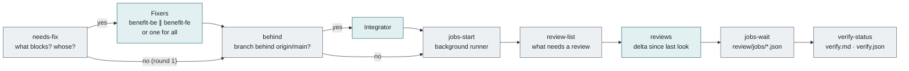

# Benefits Feature Pipeline

One command takes an approved spec to draft pull requests in `benefit-be` and `benefit-fe`. Separate agents plan, decide, build and review; scripts check every step; you're asked only when automation can't decide, and you review the result on the draft PRs.

```bash
workflows/benefit-feature/run.sh start 003        # or /feature-workflow in chat
workflows/benefit-feature/run.sh watch 003        # live progress, in a second terminal
```

Each feature runs in its own git worktree (section 7), so several features can run side by side while you keep working in your checkout.

A designed version of this page is published as an artifact: [Benefits Feature Pipeline](https://claude.ai/artifact/M1L7pdUf9uMiZK6A2LhJ94) (private; share it from the page's Share menu). This file is the source of truth; update it when the workflow changes.

**Legend:** teal = AI session (one agent, its own `claude -p` session) · grey = script (deterministic check or command) · amber dashed = you (only when needed).

## 1. How the pieces fit


The engine never writes code. It is the orchestrator: it starts each **agent** as its own session, with its own context, for work that needs judgement (planning, tasks, test design, coding, reviewing, fixing) and **scripts** for everything that can be checked mechanically, and moves on only when a script says the last step passed. Only the PR step leaves your machine.

## 2. The pipeline

```mermaid
flowchart TB
    spec["Pick up the spec<br/>sync · prepare"]:::script
    sc["Spec clarifier, only if the spec has open questions<br/>answers on the evidence · each answer listed in the PR"]:::ai
    g0["clarify-gate"]:::script
    q1{{"A question only a person can answer?<br/>you answer in spec.md (rare)"}}:::you
    arch["Architect<br/>plan · research · data model · contracts<br/>ADRs · scope.json · brief.md"]:::ai
    g1["plan-gate"]:::script
    dm["Decision-maker, only if an ADR is open<br/>decides on the evidence · never amends rules<br/>each decision listed in the PR"]:::ai
    g3["decisions-gate"]:::script
    upd["Architect again<br/>only if another option was chosen"]:::ai
    q2{{"No compliant option?<br/>you decide (rare)"}}:::you
    spect["Spectator<br/>test-plan.md · a lane and repo per case<br/>from the brief and the plan as decided"]:::ai
    gt["test-gate"]:::script
    tasks["Tasks, written once<br/>plan + ADRs + test plan · tagged by lane<br/>a task for every case and ADR"]:::ai
    g2["tasks-gate"]:::script
    sint["Branches · integrator, only if an earlier<br/>run's branch is behind main"]:::ai
    contracts["Contracts, alone<br/>packages/domain · OpenAPI · dependencies"]:::ai

    lanes["Lanes and the QA tests, in parallel, one session each<br/>workflows · agents · data · platform-ui · qa<br/>tests first · own unit tests green"]:::ai

    qa["QA step, only for what needed the lanes' code<br/>late contracts · QA tests wired to the code"]:::ai

    subgraph verify["Verify loop · ≤6 rounds"]
        direction TB
        fix["Fixers (from round 2)<br/>one per repo in parallel, or one for all<br/>coding model"]:::ai
        integ["Integrator, only if main moved<br/>merges origin/main · resolves clashes<br/>main wins · one ADR for the PR"]:::ai
        jobs["Jobs, in the background<br/>e2e first · make check · build · eval · main<br/>ownership · tasks · trace"]:::script
        reviews["Reviews, at the same time<br/>code benefit-be · code benefit-fe · compliance<br/>only those with no result, blocking, or changed"]:::ai
        status["verify-status"]:::script
        fix --> integ --> jobs
        integ --> reviews
        jobs --> status
        reviews --> status
        status -. "blocking: next round" .-> fix
    end

    final["final-gate<br/>nothing blocking"]:::script
    pr["Draft PRs<br/>create-pr · feature branch, never main<br/>one per repo · linked"]:::ai

    subgraph gha["GitHub Actions · ≤3 rounds"]
        direction TB
        ciwait["ci-wait<br/>each repo's own CI · failing logs to review/ci.md"]:::script
        cifix["CI fix<br/>reads the failing logs · fixes · make check<br/>commits and pushes to the feature branch"]:::ai
        ciwait -. "red" .-> cifix
        cifix -- "push: CI runs again" --> ciwait
    end

    ready["Ready for review<br/>gh pr ready when all green"]:::script
    cigate["ci-gate<br/>still red after 3 rounds: stop"]:::script

    spec --> sc --> g0 --> arch --> g1 --> dm --> g3 --> spect --> gt --> tasks --> g2 --> sint --> contracts --> lanes --> qa --> verify
    spec -- "no open questions" --> g0
    g0 -.-> q1
    g1 -- "nothing open" --> spect
    g3 -. "chose differently" .-> upd -.-> spect
    dm -.-> q2
    verify -- "clean" --> final --> pr --> gha
    gha -- "all green" --> ready
    gha -. "still red" .-> cigate

    classDef ai fill:#E2F0F1,stroke:#1D6B74,color:#17212B
    classDef script fill:#EDF0F3,stroke:#536273,color:#17212B
    classDef you fill:#FAEEDF,stroke:#9C5512,color:#17212B,stroke-dasharray:5 3
```



Each teal box is a separate agent session. Stages that depend on each other run in a chain; work that doesn't (the lanes and the QA tests, the fixers for the two repos, the jobs and the reviews) runs in parallel. Planning is checked by one gate per stage; everything about the code is checked inside the verify loop, so any failure there goes to a **fixer** instead of stopping the run. Each round ends on a verification, so a fix is never shipped unchecked. A failed gate stops the run; fix the cause and `specify workflow resume <run-id>`.

### Inside one verify round



`jobs-start` hands the jobs to a background runner and returns at once, so the reviews run while the tests do; nothing edits the code until `jobs-wait`, so both see the same code, and the next round's fix gets the failing jobs and the review findings together. `review-list` reruns a review only when it has no result, still has blocking findings, or one of its repos changed since it last looked. It records the trees it reviewed, so `wf.py delta` can show a re-review exactly what changed, new files included. With `-i review_mode=on_green`, `review-list` waits for the jobs and runs no review while one fails (fewer review tokens, usually one more round).

`needs-fix` splits the fix by repo when every blocker belongs to one: failing `benefit-be:*` or `benefit-fe:*` jobs, a code review's findings, and compliance findings by the repo of their file. The two fixers then work side by side, each only in its own clone. A blocker that spans both (`e2e`, `trace`, `tasks`, `ownership`, a finding outside both repos) gets one fixer for everything. `main` needs no fixer (the integrator merges it), and nor does a review with no valid result (it reruns).

## 3. Stage by stage

| # | Stage | What happens | Output | Checked by |
|---|---|---|---|---|
| 0 | Spec (you) | You write the spec with `/speckit-specify` (and `/speckit-clarify` if you want to answer its questions yourself). The run starts from it. | `spec.md` | `prepare` |
| 0b | Clarify (AI) | Only if the spec has `[NEEDS CLARIFICATION]` markers: the spec-clarifier agent, which didn't write the spec, answers each one on the evidence (the spec's goal, the constitution, the rules, earlier specs, policy sources, the code) and records the answer and when to revisit it. A question only a person can answer stays open for the spec gate. | answered `spec.md`, `clarifications.json` | `clarify-gate` |
| 1 | Plan (AI) | The architect agent plans against the real code, the constitution and earlier decisions, records significant decisions as ADRs, and decides which lanes and repos are involved. Product, policy, cost, scope and amendment questions stay open, with options and a recommendation. It ends with `brief.md` (requirements, rules, code and tests involved, open decisions), which the decision-maker and spectator read first. | `plan.md`, `research.md`, `data-model.md`, `contracts/`, `decisions/`, `scope.json`, `brief.md` | `plan-gate` |
| 1b | Decide (AI) | Only if an ADR is open: the decision-maker agent, which didn't plan the feature, decides each one on the evidence and records why and when to revisit. If it chose other than the recommendation, the architect updates the plan, before the test plan is written. | decided ADRs, `decisions/auto-decisions.json` | `decisions-gate`, `plan-gate` |
| 1c | Test plan (AI) | The spectator agent, which didn't plan the feature or decide its ADRs, maps every requirement and acceptance scenario to named test cases at the lowest level that proves them, including the failure paths, each with the lane and repo that will own it. It starts from the architect's `brief.md` instead of reading everything again. | `test-plan.md` | `test-gate` |
| 2 | Tasks, once (AI) | Spec Kit's tasks, written in one pass from the plan, the decided ADRs and the test plan: a test-first task in its lane for each lane case, a `[qa]` task for each cross-lane case, tasks for each ADR's "Work this creates", each tagged with one lane and repo. Nothing adds tasks afterwards. | `tasks.md` | `tasks-gate` |
| 3 | Contracts (AI) | Feature branches from `origin/main` in the repos in `scope.json` (an existing branch with no commits of its own is fast-forwarded; one with its own work that main has passed goes to the integrator first), then the shared changes every lane depends on, done first and alone. | domain models, OpenAPI, dependencies | verify loop |
| 4 | Lanes and QA tests (AI ×5) | Each lane implements its own tasks, tests first, in its own folders, and gets its own unit tests green in the same session. At the same time the qa item writes the planned contract, integration, end-to-end and eval tests against the contracts and plan, in the QA test folders only. | code per lane, QA tests, `lanes/<lane>/done.json` | verify loop |
| 5 | QA step (AI) | Only if there is work left for it: the `[qa]` tasks that needed the lanes' code (in `lanes/qa/blocked.md`) and the late `[contracts]` tasks; it also wires the QA tests to what the lanes built, never weakening an assertion. | tests | `qa-remaining`, verify loop |
| 6 | Verify (script + AI) | Fixers (from round 2, one per repo where they can); the integrator if `origin/main` moved; then in the background: `e2e` (benefit-be's `make verify-stack`: integration, the stack and `pnpm e2e`, as in CI), `make check`, builds, evals, `main` (the branch contains `origin/main`), `ownership` (files in their lane), `tasks` (none left open) and `trace` (every planned test defined by its exact name and not skipped); and, meanwhile, the reviews that need it, in parallel. | `review/verify.md`, `review/trace.md` | `verify-status`, `final-gate` |
| 7 | Ship (AI + script) | Draft PRs from the feature branch (never `main`), one per repo and linked, backend first if the API changed. Then each repo's GitHub Actions: a red check's log goes to a CI fix step, which fixes it, runs `make check`, commits and pushes to the same branch, and CI runs again (up to 3 rounds). When all checks are green, the draft PRs are marked ready for review. | PR URLs, `review/ci.md` | `ci-wait`, `ci-gate` |

## 4. Who does what

Every AI step is an **agent**: a `*.agent.md` file with its rules (role, scope, responsibilities, evidence, editing and communication), plus its own procedures in `skills/` when it has any. Each runs as a separate subagent with its own context and talks to the others only through files. The engine starts them, in parallel where the work is independent; in chat, the main session does the same (for example the three reviewers through `review-changes`). Shared conventions: [agents/README.md](../agents/README.md).

| Agent | Does | Writes | Skills |
|---|---|---|---|
| [Architect](../agents/architect/architect.agent.md) | Turns the spec into a buildable plan; makes the decisions that are its to make; frames the rest with options and a recommendation | plan artefacts, ADRs, `scope.json`, `brief.md` | `architecture-plan`, `architecture-decision`, `architecture-capabilities` |
| [Spec clarifier](../agents/spec-clarifier.agent.md) | Answers the spec's open questions independently, on the evidence: product by the spec's goal and earlier features, policy by its sources (else a caseworker decides), data by the most conservative option; leaves open only what a person alone can know | answered `spec.md`, `clarifications.json` | — |
| [Decision-maker](../agents/decision-maker.agent.md) | Decides the open ADRs independently, on the evidence: product and scope by the spec, policy by its sources, cost by the cheapest compliant option; never amends the constitution or a rule | decided ADRs, `decisions/auto-decisions.json` | — |
| [Spectator](../agents/spectator/spectator.agent.md) | Decides how each requirement is proven, after the plan and its decisions and before any task: test level, edge cases, synthetic data, eval thresholds, and the lane and repo of each case | `test-plan.md` | `test-strategy` |
| [Compliance reviewer](../agents/compliance-reviewer/compliance-reviewer.agent.md) | Checks the implementation against the constitution, the rules for each changed path, Accepted ADRs and the test plan | `review/compliance.md` + `.json` | `compliance-review` |
| [Integrator](../agents/integrator.agent.md) | Merges `origin/main` into the feature branch when another feature has landed, and resolves every clash, textual or semantic (the same collection, migration number, contract or worker defined twice), by intent: main wins unless that breaks one of this feature's requirements | the merge commit, one `ADR-…-align-with-main`, `review/integrate.md` | — |
| [Backend reviewer](../agents/backend-reviewer.agent.md) | Senior code review of `benefit-be`: bugs, async and MongoDB mistakes, Temporal in practice, security, tests, design | `review/code-benefit-be.md` + `.json` | — |
| [Frontend reviewer](../agents/frontend-reviewer.agent.md) | Senior code review of `benefit-fe`: state and data bugs, security, accessibility, tests, API-contract fit | `review/code-benefit-fe.md` + `.json` | — |

The decision-maker is separate from the architect on purpose: the agent that framed the options doesn't grade them. Its decisions aren't hidden: each one is in `decisions/README.md` and in a "Decided automatically" section of the PR, with what the architect recommended and when to revisit it. The spectator is separate for the same reason: the tests are designed from the spec by an agent that didn't write the plan, and before the tasks, so every task can name the test that proves it and no step goes back to add tasks. The spec clarifier works the same way for the spec's questions: each answer is in the spec's `## Clarifications` section (an `(automated)` session) and in the same PR section.

**Lanes** (workflows, agents, data, platform-ui) are folder ownership, not agents ([backend-architecture.md](../project-rules/backend-architecture.md)). They decide which rules apply (`TW-*`, `AG-*`, `KD-*`, `PL-*`, `FE-*`) and what can run in parallel.

## 5. When it asks you

| Gate | Appears when | What you do | Continue with |
|---|---|---|---|
| Spec questions | Rare: the spec clarifier left a question open because only a person can answer it (why is in `clarifications.json`) | Answer them in `spec.md` | `-i spec_verdict=approve` |
| No compliant option | Rare: the decision-maker finds that every option for an ADR breaks the constitution or a rule (the run stops at `decisions_gate`) | Decide it, or start the amendment PR (all three team members) | fix, then `specify workflow resume <run-id>` |

There are no modes, so nothing else stops for you: starting the run is the approval to push the feature branch (never `main`), and your review happens on the PRs in GitHub: they open as drafts and are marked ready for review once GitHub Actions is green, where branch protection already requires an approval: the code, each spec answer the spec clarifier gave, and each decision the decision-maker made.

## 6. How it stays correct, and cheap

**Verification**
- Each check runs once. One gate per planning stage (`prepare`, `plan-gate`, `decisions-gate`, `test-gate`, `tasks-gate`); the skills run the same gate as their self-check so they can fix their own output first.
- Every check on the code runs inside the verify loop, so the fix step can repair it: tests, builds, evals, `e2e`, `main`, `ownership`, open `tasks` (including work a lane recorded in `blocked.md`) and `trace`.
- `trace` checks the requirements the feature's own spec defines (its `- **FR-<NNN>-xx**` items); IDs the spec only refers to, such as another spec's requirements, are left to that spec, and the task and test-plan checks count the same set. It counts a planned test only where it is defined (a Python `def`, a `test(`/`it(` title, an eval case id), in the repo the test plan names, and not skipped. A name in a comment, a skipped test or a renamed test doesn't count.
- Parallel lanes share one working tree, so `ownership` fails any file a lane doesn't own.
- Never a silent pass: a missing or unreadable result counts as blocking, and a job that couldn't run (no `make` target) is a warning in `verify.md` and the PR.
- Each repo's own GitHub Actions must pass on the PR. CI differs from a laptop (no `.env`, services only in the integration job), so a red check goes to a CI fix step that pushes to the feature branch until it's green (up to 3 rounds). Only then is a draft marked ready for review, so nobody reviews code CI hasn't passed. `trace` also flags a planned unit test placed in a folder whose tests need MongoDB or Temporal (`tests/db/`, `tests/integration/`), the mistake behind feature 001's first red CI.
- Tasks are written once and checked by a script before any code: `tasks-gate` fails if a test case in `test-plan.md` has no task, warns if an Accepted ADR or a requirement has none (the tasks step runs it as its self-check and fixes both), checks the lane tags, and moves a `[contracts]` task that waits for lane work ("after T020") to the QA step, which runs after the lanes.
- The verify loop keeps going while the blocking count falls, up to 6 rounds, and stops early after 2 rounds without progress (`review/history.json`); every fix uses `coding_model`, and every fix adds the test that would have caught its finding.
- The stack is started by a script, not by an agent: when a feature changes code, the `e2e` job runs benefit-be's `make verify-stack` (`make verify` where the repo doesn't have it yet), which starts MongoDB, Temporal and the app and runs the integration, API and `pnpm e2e` tests the way CI's e2e job does. It skips the static, unit, workflow and contract stages, which the `check` and `build` jobs run beside it. Running the stack, e2e or the quickstart is never a task, so no task stays open because an agent couldn't keep a server up. If a stack port (8000, 8001, 5173, 7233, 8233, 27017) is already taken, for example by your own `make dev`, the job doesn't run, because `make verify` resets the database. It leaves a non-blocking warning that the PR repeats, and CI's e2e job still runs on the PR. `run.sh` lists the taken ports at start.
- The branch never ships against an outdated main, and the lanes never build on one. Before the lanes, an earlier run's branch that main has passed goes to the integrator, and one with no commits of its own is fast-forwarded. Each verify round, `wf.py behind` fetches `origin/main` (only main, so other features' branches never land in the clone) and, if another feature merged meanwhile, the integrator agent commits the feature's work, merges main and resolves the clashes before the round's checks, which then test the merged code. Main wins (it's merged, may hold data, and other code depends on it): the feature takes main's names and fields, renumbers its migrations after main's, and replaces anything main marks as a stand-in for it. Every resolution goes in one ADR, listed for review in the PR like the decision-maker's. If keeping both sides' requirements is impossible, it aborts the merge, records the clash as `Needs decision`, and the `main` job keeps blocking. The integrator only commits on the feature branch; nothing is pushed before the PR step.
- The fix step fixes the code to meet the requirement, never the test. For each failing test it first looks up what the test proves: its case in `test-plan.md`, the requirement in `spec.md`, and any ADR. Then it changes the code to meet that requirement. It never weakens a test (expected values, pins, thresholds, names, skips), and changes a test only where it contradicts the spec, plan or an ADR. A failure caused by the machine (a missing tool, an unpinned version, a missing login) is recorded as an environment problem, not patched in the code. Each round's reasoning is in `review/fixes-<scope>.md` (`fixes-benefit-be.md`, `fixes-benefit-fe.md`, or `fixes-all.md`). A fixer reruns the tests that failed and those of the code it changed, plus lint and types; the full suites run in the jobs right after it.
- Before handing over, each lane reviews its own diff against the reviewer's checklist and the ADRs' "How we verify it", and the spectator plans the failure paths reviewers block on (retries running out, every API error body, recorded refusals), so fewer findings reach the reviews at all.
- Running a feature again (its spec changed) updates instead of starting over: `prepare` clears the earlier run's lane reports, the tasks step keeps each ticked task the code on the branch still satisfies, reopens the ones that no longer match and adds tasks only for what isn't built (including new test cases), and the spectator extends `test-plan.md` first, keeping existing case IDs.
- Jobs run side by side and share each repo's git index (they stage the working tree so a generated-file check means "regenerating changed something"): the first job in saves the real index, the last one out puts it back, under a lock. The reviewers, running at the same time, read the change with `wf.py changes` and `wf.py delta`, which don't use the index. A job that never reports (killed, crashed, timed out) counts as failed.
- After the code, the `tasks` job in every verify round blocks while any task is open; the tests, `trace` and the reviews prove the ticked ones were really done.
- The checks are tested themselves: `python3 -m unittest discover -s workflows/benefit-feature/tests` runs the tests for every `wf.py` command plus Spec Kit's validator on `workflow.yml`.

**Token economy**
- Four agent sessions plan the whole feature (architect; spectator; tasks; contracts), plus the spec clarifier only when the spec has open questions, the decision-maker only when an ADR is open, and the architect again only if it chose another option. Tasks are written once: no session goes back to add test tasks.
- The architect's `brief.md` lists the requirements, rules, code and tests it found, so the decision-maker and spectator open a source only when a choice or a case turns on it, instead of each reading the spec, rules and code again.
- The decision-maker and spectator run one after the other, not side by side: the test plan follows the decisions as made, so nothing is redone when the decision-maker overrules a recommendation.
- Each lane is one session: it fixes its own unit tests with its context still loaded, instead of in extra fix sessions.
- Three model inputs: `judgement_model` (default `opus`) for the spec clarifier, architect, decision-maker, integrator and reviewers; `test_plan_model` (default `sonnet`) for the spectator, whose output `test-gate` and the verify loop's `trace` check (set it to `opus` if reviews keep finding cases a test plan should have had); `coding_model` (default `sonnet`, much faster) for everything that implements, tests or verifies against a written plan: tasks, contracts, lanes, QA tests, every fix, PRs and CI fixes. Tests, builds and checks are scripts and use no model. Override either with `-i coding_model=opus`, for example.
- Later rounds rerun only the reviews with no result, still blocking, or whose repo changed. With the default `review_mode=parallel` a review can also run on a round whose jobs fail, which costs review tokens but saves a round; `on_green` saves those tokens.
- Re-reviews read only `wf.py delta`, the change since they last looked.
- Each agent reads only the rule files mapped to the paths it touches, and the diff.
- Results go to files; replies are a few lines.

**Speed** (measured on feature 001's runs, where fix rounds were 24–39 minutes of 64–93)
- The reviews run while the jobs do, so one fix round handles both the failing tests and the findings, instead of a round for each.
- The fix is split by repo when it can be, so the backend and frontend fixes run side by side.
- The QA tests are written beside the lanes; only what needs the lanes' code waits for them.
- `e2e`, the longest job, starts first and doesn't repeat the other jobs' stages.
- A fixer runs only the tests it needs; the jobs run the full suites straight after.
- An earlier run's branch catches up with main before the lanes, not late in the verify loop.

## 7. Running it

Always go through `run.sh`. It checks the machine, gives the feature its own worktree, and gives every agent step its permissions before handing over to the engine.

```bash
R=workflows/benefit-feature/run.sh
$R check                       # preflight only: tools, gh login, permissions file, repos (changes nothing)
$R start 003                   # start: agents decide, then draft PRs, ready once CI is green
$R watch 003                   # live view of 003's latest run (second terminal), with a macOS notification
                               # when it waits for you, fails or finishes; Ctrl+C stops watching only
$R status 003                  # the engine's own summary (a run id or NNN; nothing = the latest of any run)
$R resume 003                  # continue 003's latest run after fixing what stopped it
$R resume <run-id> -i spec_verdict=approve    # answer the spec gate, only after you decided
$R worktrees                   # each feature worktree: branches, changed files, latest run
$R cleanup 003                 # after the PRs merge: remove 003's worktrees (asks; keeps the branches)
$R prepare 003                 # only create or refresh the worktree, e.g. to work in it by hand
$R start --in-place 003        # the old way, in this checkout: to try uncommitted workflow changes
```

**Worktrees.** Each feature gets `<metarepo>.worktrees/<NNN-feature>/` next to the metarepo (set `WF_WORKTREES` to move it):

```
ai-immersion-metarepo/                     your checkout: any branch, keeps working while runs go
  repos/benefit-be, repos/benefit-fe       main clones: stay free (sync-repos), share objects and refs
ai-immersion-metarepo.worktrees/003-name/  git worktree of the metarepo, on feature/003-name
  specs/003-name/                          the run writes plan, ADRs, tasks, review/ here
  .specify/workflows/runs/<id>/            this feature's run state
  repos/benefit-be, repos/benefit-fe       git worktrees of the main clones, on feature/003-name
```

Inside it every path is the same as in the checkout (`repos/<name>`, `specs/…`, `wf.py`'s root), so agents, rules and checks need no change. It sits next to the checkout rather than inside it so agents don't also load the checkout's `CLAUDE.md`. Within one run the lanes still share that run's working tree, and `ownership` keeps them in their folders. Points to know:
- The run uses the **committed** agents, rules and workflow at your checkout's `HEAD` when the worktree is created. `start` warns about uncommitted changes to them; commit them, or use `--in-place` to try them.
- The spec is copied in with its uncommitted changes when the worktree is created. After that, the worktree's copy is the one that counts: commit the spec artefacts there on `feature/NNN-name` (the metarepo branch), then `cleanup` once the PRs merge. `cleanup` refuses while anything is uncommitted and never deletes a branch.
- Each clone worktree gets its own `.venv` and `node_modules` (`uv sync`, `pnpm install`, quick from their caches) and a copy of the main clone's `.env`. All worktrees share the main clone's local `mongod` (`MONGO_DIR`), so integration tests of two runs at the same time share one database.

**What `start` does before the engine runs:**
- checks that `specify`, `claude`, `git`, `gh` (logged in), `uv`, `pnpm` and `make` are installed, and that `.claude/settings.json` is valid and allows every command the agents need (`scripts/check_permissions.py`)
- fetches the main clones, then creates the feature's worktree, or reuses it on a restart. A new clone worktree starts its branch from `origin/main` (or from an existing local or remote `feature/NNN-name`). If a main clone still has that branch checked out from an in-place run, it is moved to `main` when clean, or `start` stops with the reason
- with `--in-place`: puts each clone of the checkout on an up-to-date `main` instead (switches a clean clone that has nothing unpushed, fast-forwards it to `origin/main`, stops with the reason for anything else)
- passes `.claude/settings.json` to every `claude -p` step with `--settings` (through `SPECKIT_INTEGRATION_CLAUDE_EXTRA_ARGS`)

AI steps run unattended, so they can't ask for permission. Claude Code applies a project's `.claude/settings.json` on its own only after someone trusts the folder interactively; passing it with `--settings` works without that, on any machine. Starting the engine directly, without `run.sh`, skips all of this, and an agent step then typically ends with "Prompt exited with code 1" and writes nothing.

**`watch`** shows each stage (✓ done, ▶ running, ✗ failed, ⏸ waiting for you, – not needed, · not started) with its duration, the agent sessions running now, what each agent has produced (`plan.md`, ADRs, tasks done, test cases, verify results, PR links) and, when the run stops, the failed step, its last output, the usual cause and the exact command to continue. It only reads files.

The engine runs Claude Code; Copilot users follow the same stages by hand from [workflows/feature.md](../workflows/feature.md).

## 8. Where things live

```
ai-immersion-metarepo/
├── docs/workflow-architecture.md      this page
├── workflows/
│   ├── feature.md                     the stages, and the manual path
│   ├── benefit-feature/run.sh         start, resume, watch, worktrees, cleanup, check (use this)
│   ├── benefit-feature/workflow.yml   the pipeline
│   ├── benefit-feature/scripts/watch.py  live progress view
│   ├── benefit-feature/scripts/wf.py  every check
│   └── benefit-feature/tests/         tests for every check + workflow.yml validation
├── agents/
│   ├── README.md                      who's who + shared conventions
│   ├── architect/                     architect.agent.md + 3 skills
│   ├── spec-clarifier.agent.md
│   ├── decision-maker.agent.md
│   ├── integrator.agent.md
│   ├── spectator/                     spectator.agent.md + test-strategy
│   ├── compliance-reviewer/           compliance-reviewer.agent.md + compliance-review
│   ├── backend-reviewer.agent.md
│   └── frontend-reviewer.agent.md
├── project-rules/                     rule sets with IDs; README maps paths → rules
├── .specify/memory/constitution.md    principles I–X; overrides everything
├── specs/<NNN-feature>/               spec, plan, ADRs, tasks, test plan, review/
└── repos/benefit-be, repos/benefit-fe the main clones; each run works in ../ai-immersion-metarepo.worktrees/<NNN-feature>/
```
